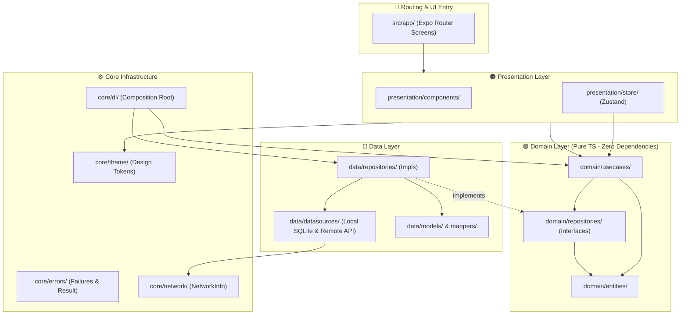
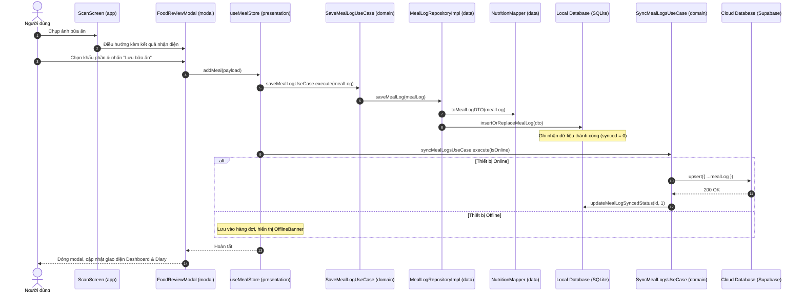

# 🏛️ TÀI LIỆU KIẾN TRÚC HỆ THỐNG — NUTRIVISION

> **Dự án:** NutriVision — AI-Powered Food Recognition & Personal Nutrition Tracker  
> **Nền tảng:** React Native · Expo SDK 58 · TypeScript · Expo Router  
> **Mô hình kiến trúc:** Clean Architecture 3 lớp kết hợp hạ tầng `core/`

---

## 1. Tổng quan kiến trúc

NutriVision áp dụng kiến trúc **Clean Architecture** (Uncle Bob) với nguyên tắc cốt lõi: **Dependency Rule** (mọi phụ thuộc hướng vào lớp Domain). 

Hệ thống được chia thành 4 phân vùng chính:
1. **`core/`**: Hạ tầng và tiện ích dùng chung (DI, Theme, Network, Functional Error Handling).
2. **`domain/`**: Lõi nghiệp vụ độc lập (Entities, Use Cases, Repository Contracts).
3. **`data/`**: Triển khai kỹ thuật (DataSources SQLite/Supabase/AI, Models/DTOs, Repository Implementations).
4. **`presentation/`**: Giao diện người dùng và trạng thái (Components, Zustand Stores).
5. **`app/`**: Điều hướng và định tuyến màn hình (Expo Router file-based routing).

---

## 2. Sơ đồ phụ thuộc (Dependency Rule)



---

## 3. Chi tiết các lớp kiến trúc

| Lớp | Trách nhiệm | Được phép import | Tuyệt đối KHÔNG import |
|---|---|---|---|
| **`core/`** | Hạ tầng dùng chung: DI container, theme, network checker, định nghĩa lỗi `Failure`/`Result`. | Thư viện hệ thống, `domain`, `data` (chỉ tại `core/di`). | UI components, React hooks (trừ theme/network helpers). |
| **`domain/`** | Lõi nghiệp vụ: Định nghĩa thực thể (`FoodItem`, `MealLog`), quy tắc logic và giao ước repository. | **Không gì cả** (Pure TypeScript thuần túy). | React, React Native, Expo, SQLite, Supabase, Presentation, Data. |
| **`data/`** | Xử lý dữ liệu: Truy vấn SQLite local, đồng bộ Supabase remote, nhận diện AI, ánh xạ DTO ↔ Entity. | `domain`, `core/network`, `core/errors`, các thư viện DB/API. | `presentation`, `app`, React components. |
| **`presentation/`** | Giao diện & trạng thái: Components dùng chung, Zustand stores điều phối Use Cases. | `domain`, `core/theme`, `core/di`, `core/network`, React Native. | `data/` trực tiếp (phải qua Use Case hoặc DI container). |
| **`app/`** | Định tuyến Expo Router: Khởi tạo ứng dụng, layout Tabs và Modals. | `presentation`, `core/theme`, `core/di`, `domain/entities`. | Các câu lệnh SQL, API fetch trực tiếp. |

---

## 4. Chi tiết cây thư mục chuẩn

```
src/
├── core/                                    # ⚙️ HẠ TẦNG DÙNG CHUNG
│   ├── di/                                  # Composition Root
│   │   ├── container.ts                     # Khởi tạo singleton Repositories & Use Cases
│   │   └── index.ts
│   ├── errors/                              # Xử lý lỗi theo hàm (Functional Error Handling)
│   │   ├── failures.ts                      # Failure, ServerFailure, CacheFailure, Result<T, E>
│   │   └── index.ts
│   ├── network/                             # Giám sát trạng thái kết nối
│   │   ├── networkInfo.ts                   # checkNetworkStatus (Expo Network)
│   │   └── index.ts
│   ├── theme/                               # Hệ thống màu sắc & cấu hình giao diện
│   │   ├── theme.ts                         # COLORS, DEFAULT_GOALS
│   │   └── index.ts
│   └── index.ts
│
├── domain/                                  # 🟢 DOMAIN LAYER (Zero Dependencies)
│   ├── entities/                            # Định nghĩa dữ liệu nghiệp vụ
│   │   ├── FoodItem.ts                      # Thực thể món ăn & dinh dưỡng khẩu phần
│   │   ├── MealLog.ts                       # Thực thể bản ghi bữa ăn
│   │   ├── DailyGoals.ts                    # Mục tiêu calo, macro, nước uống
│   │   ├── DailySummary.ts                  # Tổng kết dinh dưỡng ngày
│   │   ├── RecognitionResult.ts             # Kết quả nhận diện món ăn từ AI
│   │   ├── UserProfile.ts                   # Hồ sơ người dùng
│   │   └── index.ts
│   ├── repositories/                        # Hợp đồng giao tiếp (Contracts / Interfaces)
│   │   ├── IFoodRepository.ts
│   │   ├── IMealLogRepository.ts
│   │   ├── ISyncRepository.ts
│   │   ├── IAIRepository.ts
│   │   └── index.ts
│   └── usecases/                            # Các ca sử dụng (Business Interactors)
│       ├── food/                            # GetAllFoodsUseCase, SearchFoodsUseCase, GetFoodByIdUseCase
│       ├── meal/                            # GetMealLogsByDateUseCase, SaveMealLogUseCase, DeleteMealLogUseCase...
│       ├── ai/                              # RecognizeDishUseCase
│       ├── sync/                            # SyncMealLogsUseCase
│       └── index.ts
│
├── data/                                    # 🔵 DATA LAYER
│   ├── datasources/                         # Nguồn dữ liệu thô
│   │   ├── local/
│   │   │   ├── database.ts                  # SQLite database wrapper (WAL mode, migrations, queries)
│   │   │   └── vietnameseFoodsData.ts       # Danh mục món ăn Việt Nam khởi tạo (seed data)
│   │   └── remote/
│   │       ├── supabaseClient.ts            # Client Supabase tích hợp AsyncStorage
│   │       ├── aiRemoteService.ts           # Service nhận diện món ăn
│   │       └── networkService.ts            # Re-export network utility
│   ├── models/                              # Data Transfer Objects (DTO)
│   │   ├── FoodDTO.ts                       # Cấu trúc bảng `foods` trong SQLite
│   │   └── MealLogDTO.ts                    # Cấu trúc bảng `meal_logs` trong SQLite
│   ├── mappers/                             # Chuyển đổi dữ liệu
│   │   └── NutritionMapper.ts               # Chuyển đổi qua lại giữa DTO và Domain Entity
│   └── repositories/                        # Triển khai hợp đồng Repository
│       ├── FoodRepositoryImpl.ts
│       ├── MealLogRepositoryImpl.ts
│       ├── SyncRepositoryImpl.ts
│       ├── AIRepositoryImpl.ts
│       └── index.ts
│
├── presentation/                            # 🟠 PRESENTATION LAYER
│   ├── components/                          # UI components tái sử dụng
│   │   ├── MacroBar.tsx                     # Thanh tiến độ Macro (Protein, Carbs, Fat)
│   │   ├── MealSection.tsx                  # Khối nhóm bữa ăn (Sáng, Trưa, Tối, Phụ)
│   │   ├── OfflineBanner.tsx                # Cảnh báo ngoại tuyến & trạng thái đồng bộ
│   │   └── index.ts
│   └── store/                               # Zustand State Management
│       ├── authStore.ts                     # Phiên đăng nhập & thông tin người dùng
│       ├── goalStore.ts                     # Mục tiêu dinh dưỡng cá nhân
│       ├── mealStore.ts                     # Quản lý danh sách bữa ăn, trigger đồng bộ
│       └── index.ts
│
└── app/                                     # 📱 EXPO ROUTER ROUTES
    ├── (tabs)/                              # Điều hướng Bottom Tabs
    │   ├── _layout.tsx                      # Cấu hình thanh điều hướng 5 tab
    │   ├── index.tsx                        # Tab 1: Tổng quan (Dashboard)
    │   ├── diary.tsx                        # Tab 2: Nhật ký ăn uống
    │   ├── scan.tsx                         # Tab 3: Quét nhận diện AI
    │   ├── reports.tsx                      # Tab 4: Báo cáo xu hướng dinh dưỡng
    │   └── profile.tsx                      # Tab 5: Hồ sơ & thiết lập cá nhân
    ├── modal/                               # Màn hình dạng Modal Stack
    │   ├── food-review.tsx                  # Xác nhận món ăn & chọn khẩu phần
    │   └── manual-entry.tsx                 # Tra cứu và thêm món thủ công từ danh mục
    └── _layout.tsx                          # Root layout, SQLite & QueryClient initialization
```

---

## 5. Luồng dữ liệu mẫu (Data Flow Pattern)

### Kịch bản: Người dùng quét AI và lưu một món ăn vào nhật ký



---

## 6. Các quy tắc bất di bất dịch (Architecture Invariants)

1. **Domain là vùng cấm phụ thuộc**:
   - `src/domain/` tuyệt đối không được chứa bất kỳ câu lệnh `import` nào từ `react`, `react-native`, `expo-*`, `@supabase/*`, `src/data/`, hay `src/presentation/`.
2. **Presentation không gọi trực tiếp Database**:
   - Các file trong `src/presentation/` và `src/app/` không được phép gọi trực tiếp các hàm SQL hoặc Supabase Client. Mọi thao tác ghi/đọc dữ liệu phải thông qua Use Cases được cấp phát bởi `core/di`.
3. **Offline-First làm trung tâm**:
   - Mọi bản ghi người dùng (`MealLog`) luôn được lưu vào SQLite cục bộ trước (`synced = 0`). Sau đó tầng điều phối mới kích hoạt Use Case đồng bộ lên đám mây khi có kết nối mạng.
4. **Xử lý lỗi an toàn**:
   - Ưu tiên sử dụng kiểu dữ liệu `Result<T, Failure>` thay cho việc `throw exception` không kiểm soát qua các ranh giới kiến trúc.

